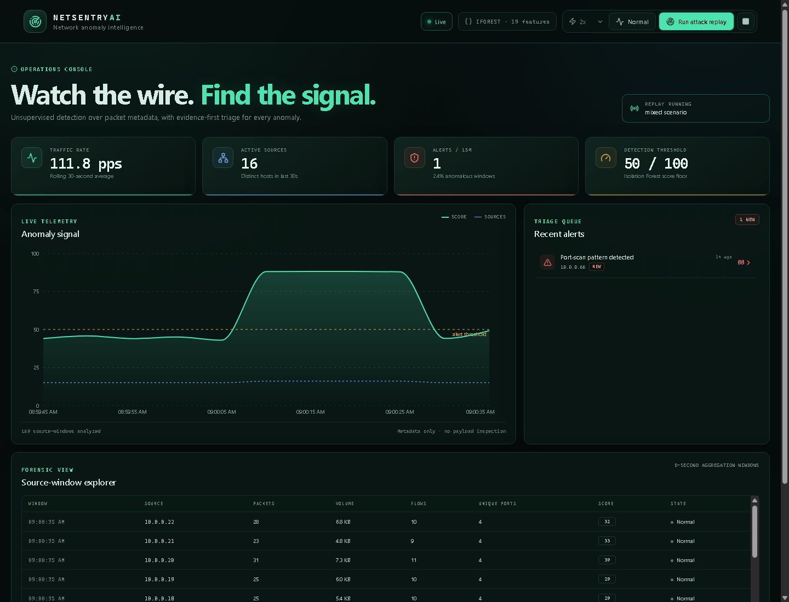

# NetSentry AI

NetSentry AI is a local-first network anomaly detection and triage console. It converts packet
metadata into fixed-time source windows, scores each window with an unsupervised Isolation Forest,
and streams the resulting alerts to a React operations dashboard.

The demo uses synthetic PCAP files so it runs without root privileges, Npcap, or external APIs.



## What is included

- Packet metadata parser for IPv4/TCP/UDP/ICMP/DNS captures using Scapy
- Five-second, per-source feature aggregation
- Isolation Forest training and inference pipeline
- Human-readable anomaly evidence based on robust feature deviations
- FastAPI REST API and WebSocket event stream
- React + TypeScript dashboard with:
  - live anomaly timeline
  - traffic KPIs
  - alert triage queue
  - alert evidence drawer
  - source-window explorer
  - normal and attack PCAP replay controls
- SQLite persistence
- Synthetic normal and mixed attack PCAP generation
- API and feature-extraction tests

## Architecture

```text
PCAP replay / capture
        |
        v
Scapy packet reader
        |
        v
5-second source-window feature extractor
        |
        v
Isolation Forest + robust-z-score explanations
        |
        +------------> SQLite
        |
        v
FastAPI REST + WebSocket
        |
        v
React dashboard
```

The detector scores host-level windows rather than individual flows. Related flow metadata is kept
for evidence and drill-down.

## Quick start

### 1. Backend

From the repository root:

```powershell
.venv\Scripts\Activate.ps1
pip install -r backend\requirements.txt
Set-Location backend
uvicorn app.main:app --reload --port 8000
```

On first startup the application creates synthetic PCAPs and trains the model automatically. This may
take a few seconds. API documentation is available at <http://127.0.0.1:8000/docs>.

### 2. Frontend

In a second terminal:

```powershell
Set-Location frontend
pnpm install
pnpm dev
```

Open <http://127.0.0.1:5173>.

### Production-style local run

Build the frontend once:

```powershell
Set-Location frontend
pnpm build
Set-Location ..
Set-Location backend
uvicorn app.main:app --port 8000
```

Then open <http://127.0.0.1:8000>. FastAPI serves the built frontend from `frontend/dist`.

## Demo walkthrough

1. Open the dashboard.
2. Select a replay speed and click **Run attack replay**.
3. Watch the dashboard stream source windows and anomaly scores.
4. The mixed capture contains:
   - a port scan from `10.0.0.66`
   - a SYN flood from `10.0.0.77`
   - a DNS query burst from `10.0.0.88`
5. Open an alert to see the top feature deviations and supporting flow-window metrics.
6. Acknowledge the alert or mark it as benign.

The **Normal** control replays only baseline traffic. The **Run attack replay** control replays a mixed
capture with both baseline traffic and injected attacks.

## API

| Method | Endpoint | Purpose |
|---|---|---|
| GET | `/api/health` | Service and replay status |
| GET | `/api/summary` | KPIs, model threshold, and timeline |
| GET | `/api/flows` | Recent source windows |
| GET | `/api/alerts` | Alert queue |
| GET | `/api/alerts/{id}` | Alert plus flow evidence |
| PATCH | `/api/alerts/{id}` | Set status to `acknowledged` or `benign` |
| GET | `/api/model/info` | Model metadata |
| POST | `/api/demo/start` | Start normal or mixed replay |
| POST | `/api/demo/stop` | Stop replay |
| POST | `/api/reset` | Clear windows and alerts |
| WS | `/ws/live` | Live window, alert, and replay events |

## Detection design

### Features

Each source IP receives one vector every five seconds. Windows with fewer than 10 packets are discarded
so that capture boundaries do not look anomalous.

- packet and byte volume
- flow count
- unique destination IPs and ports
- SYN, ACK, and RST counts
- SYN/ACK ratio
- SYN-to-packet and completed-handshake ratios
- DNS query count and DNS-to-packet ratio
- ports per destination
- TCP and UDP traffic shares
- mean packet size
- bytes per flow
- packets per second

### Model

The detector is a hybrid of unsupervised learning and evidence validation:

1. An `IsolationForest` is trained on normal synthetic traffic and proposes candidate windows when the
   raw anomaly score exceeds the 99th percentile of the training distribution.
2. A robust-deviation gate requires at least one feature to be more than 50 robust standard deviations
   from the training median. This suppresses low-volume edge windows and ordinary traffic variation.
3. The final score combines the normalized Isolation Forest score with a log-scaled deviation score.
   Non-alert windows are capped below the 50-point threshold.

```text
model_score     = clamp(100 * raw_score / (2 * threshold_raw), 0, 100)
deviation_score = clamp(100 * log10(max_abs_z + 1) / log10(1000), 0, 100)
alert_score     = 0.25 * model_score + 0.75 * deviation_score
```

Alerts are rate-limited per source to avoid alert storms. The dashboard reports anomalies, not confirmed
compromises.

### Explanations

For each alert, NetSentry reports the three largest robust deviations from the training baseline:

```text
deviation = (observed - training_median) / robust_scale
```

## PCAP generation and model training

Synthetic captures are generated at `data/samples/normal.pcap` and `data/samples/mixed.pcap`, and the
model artifact is stored at `data/models/isolation_forest.joblib`. Delete the model artifact to retrain
on the next backend startup.

```powershell
Remove-Item data\models\isolation_forest.joblib
```

## Tests

```powershell
Set-Location backend
..\.venv\Scripts\python.exe -m pytest
```

## Live capture

The MVP is intentionally built around PCAP replay. Live capture can be added with Scapy by replacing
the replay source with `sniff(iface=...)` and passing `PacketRecord` objects into the same
`WindowFeatureExtractor`. On Windows this requires Npcap; on Linux it requires capture privileges.

Live capture is omitted from the default demo because it depends on host networking permissions and
would make the project less reproducible.

## Scope and safety

- Only packet headers and metadata are analyzed. Payload bytes are not inspected or stored.
- The synthetic attacks demonstrate detection concepts, not production threat intelligence.
- The dashboard marks anomalies, not confirmed compromises.
- No automatic firewall changes or blocking actions are performed.
- Before exposing the API publicly, add authentication, authorization, HTTPS, CSRF protection, and
  stricter deployment controls.
